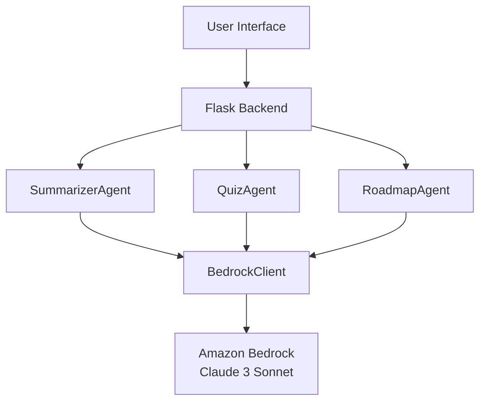

# 🎓 GenAI Study Coach

A complete GenAI-powered Study Assistant built with Python Flask and Amazon Bedrock (Claude 3 Sonnet). This application uses an agentic AI approach with three specialized agents to help students study more effectively.

## ✨ Features

- **📝 Note Summarization**: Get concise bullet-point summaries of your study notes
- **❓ Quiz Generation**: Generate 5 multiple-choice questions to test your knowledge
- **🗺️ Study Roadmap**: Create a personalized 7-day study plan

## 🏗️ Architecture



### Agentic AI Design

The application uses three specialized agents:

1. **SummarizerAgent**: Processes study notes and returns structured bullet-point summaries
2. **QuizAgent**: Generates exactly 5 MCQ questions with options and answers in strict JSON format
3. **RoadmapAgent**: Creates a 7-day study roadmap breaking down topics into daily goals

Each agent communicates with Amazon Bedrock via a shared BedrockClient wrapper.

## 📁 Project Structure

```
GenAI-Study-Coach/
├── backend/
│   ├── agents/
│   │   ├── summarizer_agent.py
│   │   ├── quiz_agent.py
│   │   └── roadmap_agent.py
│   ├── service/
│   │   ├── bedrock_client.py
│   │   └── config.py
│   ├── templates/
│   │   └── index.html
│   ├── static/
│   │   ├── script.js
│   │   └── style.css
│   └── app.py
├── requirements.txt
├── .env.example
├── README.md
└── START_CLOUD9.md
```

## 🚀 Quick Start (Cloud9)

See [START_CLOUD9.md](START_CLOUD9.md) for detailed Cloud9 setup instructions.

### Local Setup

1. **Clone and navigate to project**:
   ```bash
   cd GenAI-Study-Coach
   ```

2. **Create virtual environment**:
   ```bash
   python3 -m venv venv
   source venv/bin/activate  # On Windows: venv\Scripts\activate
   ```

3. **Install dependencies**:
   ```bash
   pip install -r requirements.txt
   ```

4. **Configure environment**:
   ```bash
   cp .env.example .env
   ```

5. **Run the application**:
   ```bash
   export AWS_REGION=us-east-1
   export MODEL_ID=anthropic.claude-3-sonnet-20240229-v1:0
   python backend/app.py
   ```

6. **Access the app**:
   - Open browser to `http://localhost:8080`

## 🧪 API Testing

### Summarize Notes
```bash
curl -X POST http://localhost:8080/summarize \
  -H "Content-Type: application/json" \
  -d '{"text": "Python is a high-level programming language."}'
```

### Generate Quiz
```bash
curl -X POST http://localhost:8080/quiz \
  -H "Content-Type: application/json" \
  -d '{"text": "Machine learning is a subset of AI."}'
```

### Create Roadmap
```bash
curl -X POST http://localhost:8080/roadmap \
  -H "Content-Type: application/json" \
  -d '{"text": "Learn AWS services including EC2, S3, Lambda."}'
```

## 🔧 Configuration

### Environment Variables

- `AWS_REGION`: AWS region for Bedrock (default: `us-east-1`)
- `MODEL_ID`: Bedrock model ID (default: `anthropic.claude-3-sonnet-20240229-v1:0`)

### AWS Credentials

The application uses boto3, which automatically looks for credentials in:
- Environment variables (`AWS_ACCESS_KEY_ID`, `AWS_SECRET_ACCESS_KEY`)
- AWS credentials file (`~/.aws/credentials`)
- IAM role (when running on EC2/Cloud9)

## 📊 API Endpoints

| Endpoint | Method | Input | Output |
|----------|--------|-------|--------|
| `/summarize` | POST | `{"text": "..."}` | `{"summary": "..."}` |
| `/quiz` | POST | `{"text": "..."}` | `{"quiz": [{question, options, answer}, ...]}` |
| `/roadmap` | POST | `{"text": "..."}` | `{"roadmap": "Day 1: ..."}` |

## 🛠️ Technology Stack

- **Backend**: Python Flask
- **AI Service**: Amazon Bedrock (Claude 3 Sonnet)
- **AWS SDK**: boto3
- **Frontend**: Vanilla JavaScript, HTML5, CSS3

## 📝 License

MIT License - Feel free to use this project for learning and development.
